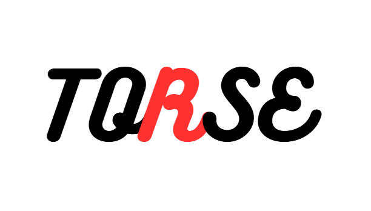

<p align="center">
  
</p>

# Torse

Torse是一个用Rust编写的开放方块世界内核与开发框架，提供世界存储、模拟执行、持久化、网络同步和Mod扩展能力，并通过基础游戏验证这些能力如何共同工作。

项目将通用框架与具体玩法分开：内核负责世界状态和执行规则，玩法由内容定义、可选模块与Mod组合。客户端和服务端共用领域模型，世界修改经过统一授权与事务提交，再交给存储和网络层处理。

[快速开始](#快速开始) | [项目结构](#项目结构) | [开发与验证](#开发与验证)

## 开发状态

Torse目前处于早期开发阶段，已有可运行的图形客户端、独立服务端与Mod示例。现阶段主要验证世界编辑、持久恢复和联机交互，接口与存档格式仍在演进。

| 领域 | 已实现的范围 | 验证记录 |
|---|---|---|
| 世界与地形 | 方块状态、分区存储与流式装载、确定性地形生成、碰撞检测和网格生成 | [世界场景](benchmarks/M1-scenario.md) |
| 模拟与事务 | 固定步长Tick、阶段调度、实体与组件、动作授权、库存转移和跨模块原子提交 | [Tick执行](benchmarks/M2-tick.md)、[跨模块事务](benchmarks/M4-cross-module.md) |
| 图形客户端 | 窗口与离屏渲染、飞行与行走、方块选择与编辑、HUD、菜单和截图 | [窗口交互](benchmarks/M1-window.md)、[界面基础](benchmarks/M1-ui.md) |
| 持久化 | 日志、检查点、实体生命周期恢复、持久任务与定时事件、请求结果与去重 | [世界恢复](benchmarks/M3-local-world.md)、[执行与网络](benchmarks/B6-B7-execution-network.md) |
| 联机 | TCP连接、授权基线与增量同步、多人编辑、越界拒绝、撤权与重连 | [联机编辑](benchmarks/M5-net-edit.md)、[授权验收](benchmarks/A8-acceptance.md) |
| Mod扩展 | 公开SDK、Wasm包加载、机器加工、持久唤醒，以及机器状态与库存的共同提交 | [Mod持久执行](benchmarks/M4-mod-durable.md)、[Mod原子执行](benchmarks/M4-mod-atomic.md) |

联网移动的服务端结算与客户端校正、随玩家移动的订阅切换，以及图形界面对真实Mod机器的操作仍待接入。当前机器面板使用示例数据；放置与破坏尚未连接库存消耗和掉落。服务端使用有限世界与同步刷盘，现有功能验证不代表大规模世界或高并发性能。

## 快速开始

以下命令均在仓库根目录执行。项目通过[rust-toolchain.toml](rust-toolchain.toml)固定使用Rust 1.93.1，并在[Cargo.lock](Cargo.lock)中记录依赖版本。使用Rustup管理工具链时会按配置选择版本；图形客户端还需要可用的Vulkan、DirectX 12或Metal后端。

### 本地体验

启动交互窗口：

```sh
cargo run -p torse-client -- --window
```

| 操作 | 输入 |
|---|---|
| 移动 | WASD |
| 转向 | 按住鼠标左键或右键拖动 |
| 飞行升降 | 空格 / 左Shift |
| 切换飞行与行走 | F5，行走时空格跳跃 |
| 破坏 / 放置方块 | 短按鼠标左键 / 右键 |
| 选择方块 | 数字键1到3 |
| 调节速度 | 鼠标滚轮 |
| 菜单 / 机器面板预览 | Esc / E |
| 截图 | F12 |

也可以直接生成一张离屏截图：

```sh
cargo run -p torse-client -- --capture out.png --width 960 --height 720 --radius 2
```

离屏模式仍需要GPU。更多参数、字体配置与交互说明见[客户端文档](apps/client/README.md)。

### 联机编辑

先创建一个演示世界并启动服务端：

```sh
cargo run -p torse-server -- .work/demo-world --listen 127.0.0.1:7777 --fill --editors
```

保持服务端运行，在另一个终端启动客户端：

```sh
cargo run -p torse-client -- --window --connect 127.0.0.1:7777
```

可以再启动一个客户端，观察同一世界中的编辑结果。`--fill`只用于首次创建世界，重新打开同一目录时需去掉该参数。`--editors`会向所有连接授予演示范围内的编辑权限；省略时，客户端以访客权限连接，编辑请求会被拒绝。该策略用于本地演示，真实用户认证尚待实现。

无需图形环境时，可在服务端运行期间使用无GPU客户端示例：

```sh
cargo run -p torse-server --example headless_client -- 127.0.0.1:7777
```

服务端默认持续运行；指定`--ticks 60`可在运行60个Tick后保存并退出。持久目录、恢复行为与Mod加载方式见[服务端文档](apps/server/README.md)。

## 项目结构

仓库采用Cargo工作区组织。`crates`承载通用能力，根目录的`modules`承载可选玩法，`games/base`负责基础游戏的组合与资源。

| 路径 | 内容 |
|---|---|
| [apps](apps/README.md) | 图形客户端、独立服务端与开发工具 |
| [crates](crates/README.md) | 世界、模拟、渲染、编码、存储、协议与网络等框架库 |
| [crates/mod_sdk](crates/mod_sdk/src/lib.rs) | 面向Mod开发者的SDK |
| [modules](modules/README.md) | 库存、合成与能量等标准玩法模块 |
| [games/base](games/base/README.md) | 基础游戏的内容、规则与素材 |
| [examples/mods](examples/mods/README.md) | 通过公开SDK实现的Mod示例 |
| [tests](tests/README.md) | 跨模块场景、故障注入与测试夹具 |
| [benchmarks](benchmarks/README.md) | 可复现的验证过程、画面与测量记录 |

世界与模拟层负责权威状态及提交语义，存储与网络层通过公共契约接收结果。渲染层读取世界投影，编辑操作通过动作服务提交。修改公共类型或行为时，需要同步检查调用方、编码格式和恢复路径。

## 开发与验证

提交前执行格式、静态检查与工作区测试：

```sh
cargo fmt --all -- --check
cargo clippy --workspace --all-targets --locked -- -D warnings
cargo test --workspace --all-targets --locked
```

开发工具提供可独立复跑的场景，例如：

```sh
cargo run -p torse-tools -- content-fixture
cargo run -p torse-tools -- m1-scenario
cargo run -p torse-tools -- commit-scenario
cargo run -p torse-tools -- recovery-scenario
cargo run -p torse-tools -- persistence-scenario
```

ECS、Wasmtime与图形初始化实验需显式启用`experiments`特性：

```sh
cargo run -p torse-tools --features experiments -- ecs-probe
cargo run -p torse-tools --features experiments -- wasm-probe
cargo run -p torse-tools --features experiments -- gpu-probe
```

CI配置见[ci.yml](.github/workflows/ci.yml)。窗口交互与实际GPU画面需在本地验证；各项功能的复现命令、结果和未覆盖范围记录在[benchmarks](benchmarks/README.md)中。
