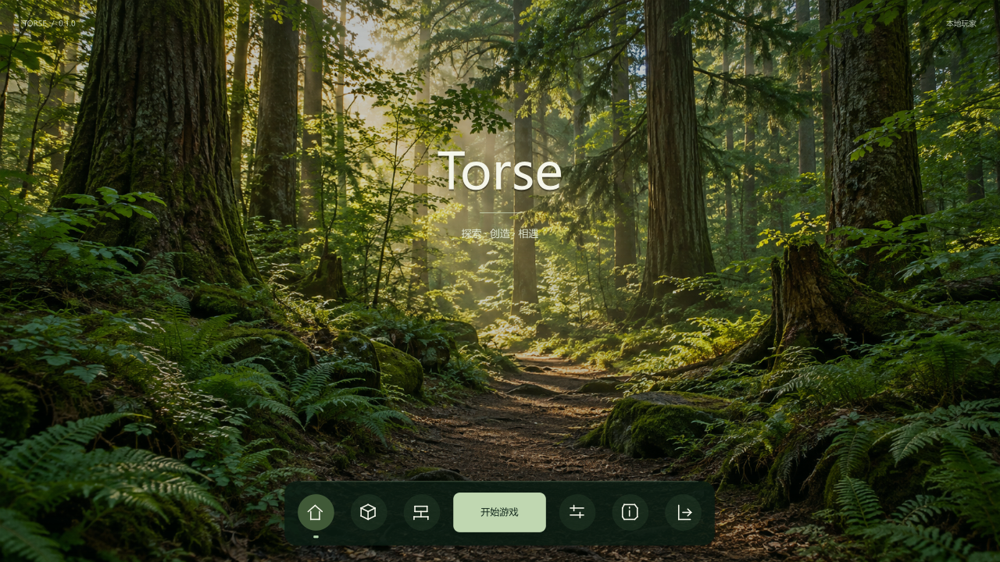
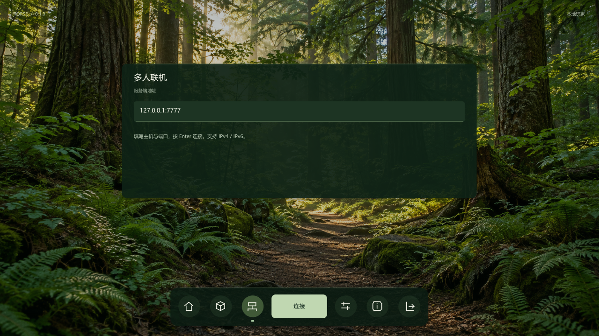
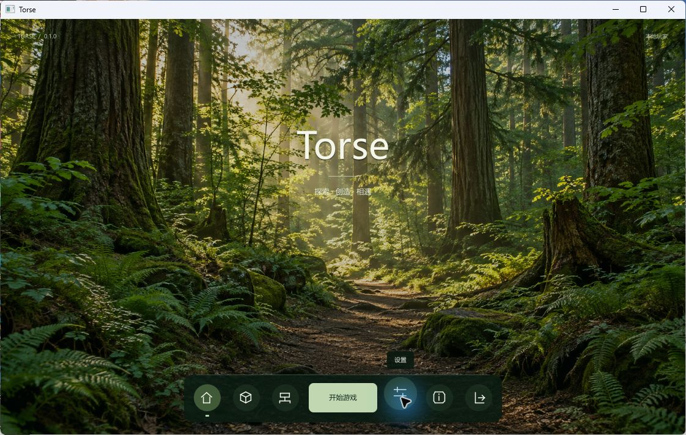
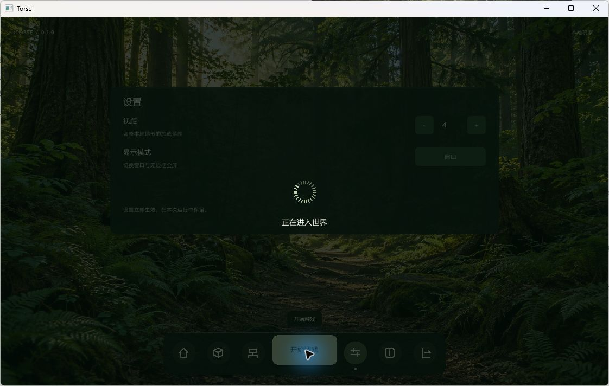
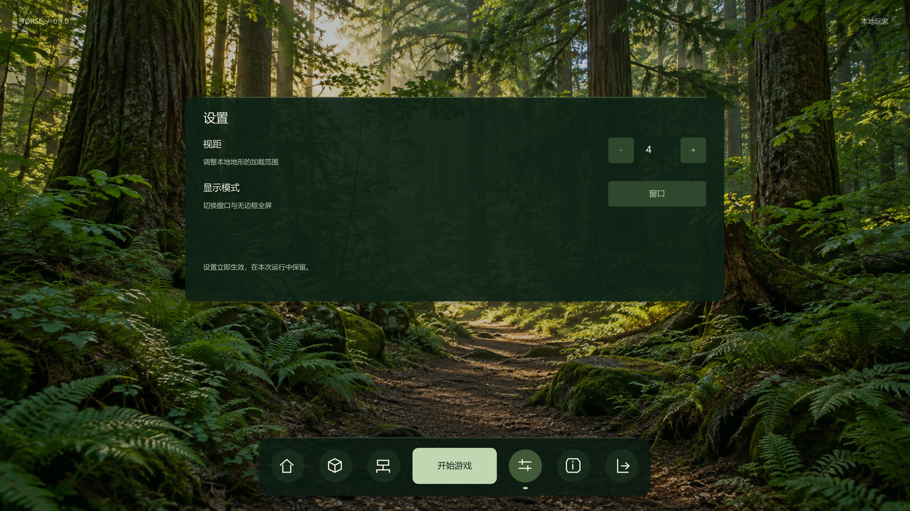

# 启动菜单与联机入口

日期：2026-10-25。环境：Windows、Rust 1.93.1、原生winit/wgpu客户端。界面已在实际窗口和GPU离屏输出中检查。

## 完成范围

| 页面 | 功能 |
|---|---|
| 开始 | 本地进入；已有会话继续游戏 |
| 本地世界 | 单一本地演示场景及退出不保存的说明 |
| 多人联机 | 主机/端口输入、全选、退格、Ctrl+V粘贴、Enter连接、等待和失败提示 |
| 设置 | 本地视距1至8、窗口/无边框全屏切换 |
| 关于 | 项目说明、许可和键盘操作提示 |
| 游戏内菜单 | 返回游戏、机器预览、返回启动页及退出，使用一致的平面按钮配色 |

不传参数或传入`--window`时默认显示首页。`--connect`、`--walk`和`--autoplay`保持直接场景入口。启动页所有输入均为模态，不向世界传递移动、编辑或自动操作。回到首页保留当前会话，继续按钮返回同一场景；选择本地世界可离开联机会话。

连接在独立工作线程建立，最多同时保留一个任务。TCP每个候选地址连接超时2秒，最多尝试4个候选；地址解析也在工作线程。连接建立后发送既有Hello和Subscribe，等待授权基线后进入游戏，基线等待有超时。失败在页面提示，保留地址便于重试；返回其他页面后不会接受迟到的连接结果。联机错误和断线会清除网络镜像与GPU实体缓冲。

背景为原创独立美术素材，来源及提示词见[素材说明](../games/base/assets/launcher/README.md)。菜单使用响应布局，640x360至2560x1440的控件范围和互不交叠检查通过，启动页按窗口物理像素绘制，布局连续缩放并读取系统DPI。字形使用实际显示字号栅格化、浮点字距和字偶距；图标采用1.5逻辑像素的抗锯齿线条，圆角与悬停变化保留小数坐标。森林图以双线性采样铺满窗口，游戏HUD保留原有像素素材缩放。

## 画面

首页使用写实森林背景，启动按钮缩小放在底部中央，其余功能图标分列两侧。悬停时图标平滑放大上移，名称在上方出现。



联机输入和设置使用深绿面板，底部入口位置保持固定。




悬停时功能名称显示在对应图标上方。



进入世界前显示原生加载转环，随后渐显场景。



2560x1440输出中的文字和图标按原始分辨率栅格化，放大后保持连续边缘。



另保留[世界页](figures/launch/02-worlds.png)、[关于页](figures/launch/05-about.png)及[640x360紧凑布局](figures/launch/06-compact.png)。

## 验证

```powershell
cargo test -p torse-client
cargo test --workspace --all-targets --locked
cargo fmt --all -- --check
cargo clippy -p torse-client --all-targets -- -D warnings
$env:RUSTDOCFLAGS = '-D warnings'
cargo doc -p torse-client --no-deps
cargo run -p torse-client -- --capture .work/startup.png --width 1280 --height 720 --radius 1 --ui-preview home
```

客户端52项测试、默认功能工作区494项测试通过。新增地址编辑测试覆盖IPv6粘贴、选择替换、退格、输入上限和连接期间禁止修改；布局测试覆盖五页在五种尺寸下的边界、命中与控件分离。格式、Clippy和Rustdoc通过。

Windows窗口实测完成本地开始、Esc菜单、返回首页、继续状态、地址粘贴、连接拒绝提示、视距调整和真实TCP连接。菜单连接到回环独立服务端，收到2个授权Section并进入游戏；返回首页继续保留同一联机会话。

## 动效与输入

页面切换先显示160毫秒的加载转环，再以260毫秒淡入与短距离位移显示内容。启动动作有340毫秒的过渡遮罩，进入世界后400毫秒渐显，期间不接纳移动和编辑。转环仅表示切换过程，不显示虚构的文件加载百分比。

悬停放大按实际时间推进，鼠标移开后平滑复原；稳定后停止重复生成界面纹理，森林底图按尺寸缓存。按钮命中范围保持固定，避免放大时遮挡或误触邻项。待执行切换可以用Esc取消，重复点击不能登记第二项动作。

新增测试覆盖不同帧率下的悬停一致性、离开后复原、页面和场景渐显结束、加载取消、单次派发与渐显期间的输入隔离。另验证100%、125%、150%、200%显示缩放下的物理指针命中、矢量边缘的部分覆盖，以及半像素页面位移的颜色与末行覆盖。离屏截图固定在动效结束状态，窗口模式使用实际时间。

## 当前边界

本地场景仍为内存演示，尚未接入多存档管理。视距与全屏设置在本次运行内保留。启动背景不代表实时场景画质；机器面板继续保留现有示例预览。没有新增账户认证、Mod下载、联网移动或持久机器图形操作。系统DNS解析没有独立强制取消，取消页面后完成的结果会被丢弃，界面线程不会等待解析。
